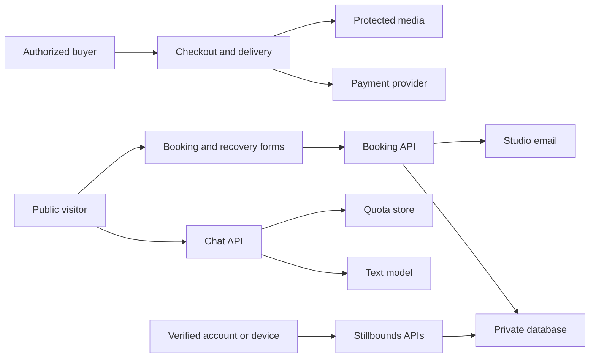

> Follow-up: [residual-risk fixes](eniyan-risk-follow-up-2026-11-15.md) supersede the earlier snapshot below for grounded Gemini replies, creation budgets and durable recovery delivery.

## Executive summary

Ẹnìyàn is a public text guide beside separate booking, shop and Stillbounds systems. The highest realistic risks are accidental provider disclosure, misleading generated advice, public-endpoint abuse and duplicate requests after uncertain delivery. No model-to-private-account or payment authorization bridge was found in this scope. The 15 November 2026 audit added controls around these risks; implementation details and tests are in [the audit report](eniyan-security-audit-2026-11-15.md).

## Scope and assumptions

- Owner-confirmed boundary: public guidance; pending booking creation only through explicit form confirmation; no model access to private customer, payment or Stillbounds records.
- In scope: chat UI/API, public knowledge/navigation, booking creation/availability/recovery/portal, shop recovery/download authorization and Stillbounds account/billing/review entry points.
- Internet-facing Next.js on Vercel with Postgres, Gemini, SMTP, Paystack and Cloudinary; infrastructure settings were inferred from repository code, not inspected in production.
- Out of scope: a full-site penetration test, production secrets, desktop binary inspection, provider infrastructure, all historical migrations and independent customer/charge/refund testing.
- Open questions that affect risk: deployment proxy-header configuration, operational traffic/abuse volume, mailbox/outbox delivery guarantees and desired portal-link expiry. These do not change the owner-confirmed model boundary.

## System model

### Primary components

- Browser chat and booking state: `components/EniyanChat.tsx`, `components/EniyanBooking.tsx`, `lib/useEniyanBooking.ts`.
- Text-only provider adapter: `app/api/eniyan/route.ts`; static knowledge derived partly from published booking rates in `lib/eniyanKnowledge.ts`.
- Separate booking endpoints and Postgres: `app/api/bookings/`; signed purchase access and protected shop delivery: `lib/purchaseAccess.ts`, `app/api/digital-products/download/route.ts`.
- Stillbounds auth/billing/reviews: `lib/stillboundsAuth.ts`, `app/api/stillbounds/`, `lib/studio/security.ts`.

### Data flows and trust boundaries

- Internet → chat API: anonymous JSON messages and route/language claims over HTTPS; streaming body/turn/character limits, shared quota, cross-site browser rejection and private-text checks. Unknown context and page text are not forwarded.
- Chat API → Gemini: bounded text plus public knowledge and normalized route/language over fixed HTTPS endpoint; server-only credential; no cookies, private database reads or callable tools; untrusted output is validated and rendered as text.
- Browser booking form → booking API → Postgres: private contact/project details and explicit confirmation/key over HTTPS, then parameterized SQL; input bounds, server-derived pricing, future slots, database conflict handling and idempotent retry. These data do not go to Gemini.
- Browser recovery form → booking API → SMTP: reference/email over HTTPS; generic response, queued lookup/delivery, IP and matched-recipient cooldown; stored recipient only; canonical HTTPS portal origin.
- Bearer-link holder → private booking portal: high-entropy token over HTTPS; bounded token, quota, parameterized token lookup and private caching. Possession authorizes access to associated client data; the model never receives the token.
- Buyer → checkout/download → Paystack/Cloudinary: scoped purchase cookie and verified paid order; server-side provider checks and protected asset delivery. The model cannot establish purchase access.
- Stillbounds user/device → account/billing/review APIs: verified session or scoped bearer/device capability, origin checks for cookie mutations, ownership and provider-signature checks. The model is not connected to these APIs.
- Application → quota store: hashed IP/resource identities through Postgres; atomic counters; trusted proxy headers are a deployment prerequisite.

#### Diagram

## Assets and security objectives

| Asset | Why it matters | Security objective (C/I/A) |
|---|---|---|
| Customer contacts, project briefs and documents | Personal/business information | C, I |
| Booking slots and request keys | Prevent duplicate/conflicting requests | I, A |
| Portal, device and purchase capabilities | Grant scoped private access | C, I |
| Payment/activation state | Prevent unpaid delivery or unauthorized licences | I |
| Gemini, SMTP and provider credentials | Prevent cost and privilege abuse | C |
| Published guidance and destinations | Keep customers on correct verified flows | I |
| Service/email capacity | Prevent quota exhaustion and mail amplification | A |

## Attacker model

### Capabilities

An unauthenticated remote attacker can post directly to public handlers, forge chat history/page claims, attempt prompt injection, distribute requests across IPs, guess reference/email pairs and provide malicious text/URLs. An authorized buyer/device can replay or tamper with their own requests. A bearer-link leak grants its holder the associated portal scope.

### Non-capabilities

No assumed access to production secrets, repository deployment rights, another user's session, the database or trusted provider infrastructure. The model cannot execute commands, select network destinations, read accounts, settle payments or call booking APIs. A supplied `confirmed: true` flag records a form contract, not proof that the caller is human.

## Entry points and attack surfaces

| Surface | How reached | Trust boundary | Notes | Evidence |
|---|---|---|---|---|
| Chat | Public POST | Internet → app → model | No privileged tools | `app/api/eniyan/route.ts` |
| Booking creation/availability | Public POST/GET | Internet → database | Idempotency, input/range limits | `app/api/bookings/route.ts` |
| Booking recovery | Public POST | Internet → SMTP | Queued generic response, cooldowns | `app/api/bookings/access/route.ts` |
| Booking portal | Token GET | Capability holder → private data | Non-expiring bearer access remains | `app/api/bookings/portal/[token]/route.ts` |
| Shop recovery/download | Public form / signed cookie | Buyer → protected delivery | Paid-order verification | `app/api/paystack/recover/route.ts`, `app/api/digital-products/download/route.ts` |
| Stillbounds billing/reviews | Session/device APIs | Identity → account/workspace | Independent authorization | `app/api/stillbounds/billing/[action]/route.ts`, `lib/studio/security.ts` |
| Client memory/navigation | Browser actions | UI lifecycle → submission integrity | Preserve mounted hook; best-effort unload warning | `components/AppChrome.tsx`, `lib/useEniyanBooking.ts` |

## Top abuse paths

1. Visitor pastes a private URL/credential → formatting defeats a pattern filter → provider receives sensitive text. New normalization and independent browser/server checks reduce this; arbitrary PII remains a risk.
2. Attacker supplies forged assistant history/instructions → model generates phishing advice or false success → visitor follows it. Reply validation and direct support forms reduce impact; tools and private records remain absent.
3. Attacker submits repeated recovery attempts → matching pair triggers SMTP across IPs → mailbox flooding or timing inference. Queued identical responses and matched-recipient cooldowns address the code gaps.
4. Attacker requests years of availability or floods public booking slots → excessive work or false pending requests. Date bounds and quotas reduce work; distributed bot submissions remain possible.
5. Visitor loses network during save → navigates to a page that used to unmount chat → loses original key → creates a duplicate request. Mounted state and identical-key retries now survive client navigation; forced tab loss remains.
6. Attacker obtains a legitimate portal/purchase/device capability → replays it → attempts broader access. Existing scoped authorization limits purchase/device scope; booking portal links require stronger future rotation/expiry policy.

## Threat model table

| Threat ID | Threat source | Prerequisites | Threat action | Impact | Impacted assets | Existing controls (evidence) | Gaps | Recommended mitigations | Detection ideas | Likelihood | Impact severity | Priority |
|---|---|---|---|---|---|---|---|---|---|---|---|---|
| TM-001 | Visitor or injected text | Private details entered in chat | Evade privacy filtering | Provider disclosure | Customer data/capabilities | `lib/privacy.ts`; server history scrub | Pattern coverage incomplete | Keep forms separate; add real evasions to tests | Aggregate rejection counts without raw text | medium | medium | medium |
| TM-002 | Anonymous attacker | Model follows malicious instruction | Generate misleading links/actions | Customer deception | Guidance integrity | `isSafeEniyanReply`; no tools | Semantic/paraphrase coverage incomplete | Preserve no-tool boundary; deterministic high-stakes navigation | Synthetic hostile-output regression suite | medium | medium | medium |
| TM-003 | Distributed sender | Known matching booking/email | Repeated recoveries or timing probes | Email abuse / match inference | Mail capacity, booking privacy | `after`, matched-recipient cooldown, generic response | Non-durable task, SMTP failures | Durable outbox; review abuse budgets at scale | Metadata-only delivery/error counts | low | medium | medium |
| TM-004 | Bots | Public endpoint access, many IPs | Scrape calendar or fill pending slots | Availability disruption | Capacity, slots | Availability bounds; shared quota; DB uniqueness | No verified-human/contact prerequisite | Add proportionate bot controls if observed | Booking volume, slot conflicts, rate-limit counts | medium | medium | medium |
| TM-005 | Network failure / lifecycle | Submission saved but response lost | Lose key then recreate request | Duplicate requests | Booking integrity | Frozen key, mounted shell, unload warning | Tab crash/forced exit | Consider scoped server request-status recovery | Duplicate-slot/request investigations | low | medium | low |
| TM-006 | Capability thief | Another user's legitimate token | Replay or broaden access | Private data/access loss | Tokens, documents, delivery, account | Signed purchase cookie, token lookups, ownership/device checks | Portal expiry/rotation policy remains | Plan portal token rotation/expiry migration | Authorization failure counters; no raw token logging | low | high | medium |
| TM-007 | Host manipulator / misconfiguration | Deployment accepts untrusted host or bad canonical origin | Redirect emailed capability to wrong host | Capability disclosure | Portal links | `bookingOrigin` now ignores request host | Production configuration not inspected | Verify canonical origin and proxy routing at release | Synthetic email-link host assertions | low | high | medium |
| TM-008 | Store outage / deployment change | Quota database down or untrusted proxy | Bypass quota/cost limits | Resource/cost abuse | Provider budget, service availability | Chat fails closed; atomic counters | IP trust deployment-dependent | Revalidate forwarded-header policy on hosting changes | Store errors and provider usage totals | low | medium | low |

## Criticality calibration

- **Critical:** remote extraction of production keys; unauthenticated arbitrary database execution. Neither was found here.
- **High:** cross-account private-document access; unpaid protected downloads or licence activation through chat. No such bridge was found in this scope.
- **Medium:** provider disclosure of pasted secrets; distributed recovery email amplification; public booking/calendar abuse. Confirmed surrounding-code gaps were fixed, with residual risks above.
- **Low:** wrong recovery-button label; lost public collection context; benign pattern-filter false positives. These affect usability but do not by themselves grant privileges.

## Focus paths for security review

| Path | Why it matters | Related Threat IDs |
|---|---|---|
| `app/api/eniyan/route.ts` | Sole model boundary, context and output policy | TM-001, TM-002, TM-008 |
| `lib/privacy.ts` | Sensitive-text detection shared with browser | TM-001 |
| `lib/eniyanNavigation.ts` | Public context and allowed destinations | TM-002 |
| `lib/useEniyanBooking.ts` | Confirmation and uncertain-result lifecycle | TM-005 |
| `app/api/bookings/route.ts` | Anonymous creation/availability and idempotency | TM-004, TM-005 |
| `app/api/bookings/access/route.ts` | Private-link email recovery | TM-003, TM-007 |
| `app/api/bookings/portal/[token]/route.ts` | Bearer capability to customer data | TM-006 |
| `lib/purchaseAccess.ts` | Purchase capability validation | TM-006 |
| `app/api/digital-products/download/route.ts` | Paid delivery enforcement | TM-006 |
| `app/api/stillbounds/billing/[action]/route.ts` | Account identity and activation/payment gates | TM-006 |
| `lib/studio/security.ts` | Device/workspace/viewer scope | TM-006 |
| `lib/rateLimit.ts` | Shared quotas and trusted proxy assumption | TM-003, TM-004, TM-008 |

## Notes on use

All discovered in-scope entry points and data boundaries are represented above. Runtime behavior is distinguished from local mocked tests/builds; no production security claim is inferred from a passing build. The owner confirmed the key capability boundary before this report. Proxy, traffic, durability and expiry assumptions remain explicit. No production scans or credential rotations were performed. The installed production dependency advisory check returned zero known advisories on this audit date. Reassess this model before adding tools, persistent memory, private retrieval or authenticated model actions.
